# Sessão diária, prática e progresso · Fretboard Trainer

App mobile (Android e iOS, testado também em Linux e macOS desktop) para guitarristas aprenderem as notas do braço da guitarra em sessões diárias de 2 a 10 minutos. Cada página a seguir mostra uma tela em tamanho real à esquerda e sua descrição à direita. O tema principal é o escuro; três telas aparecem também em tema claro, na página seguinte, com o mesmo layout. Os dados mostrados (nomes de drills, estatísticas, contagens) são exemplos. Esta versão reflete a revisão visual de 11/11/2026 (rótulos em caixa baixa, tags neutras, sem exclamação).

> Os mockups mostram exemplos em PT-BR. O MVP oferece português e inglês, além dos temas Escuro, Claro e Seguir o sistema.

## Fundamentos visuais

- Viewport de referência: 390 × 844 pt (celular, retrato); 844 × 390 pt em paisagem. Imagens exportadas a 2× (780 × 1688 px).
- Fontes: Space Grotesk 700 em títulos, nomes de nota, números e botões; Atkinson Hyperlegible 400 no texto, rótulos e chips (700 para texto forte e marca-texto). Notação com ♯ e ♭ tipográficos.
- Tema escuro (principal): fundo `#0D0F1A`, superfície `#171A2B`, texto `#EEF0FF`, acento `#B9A6FF`, destrutivo/erro `#FF6B8B`, acerto `#5CF08A`, alvo `#FFD84D`, aprendendo `#4DE2FF`.
- Tema claro: fundo `#FAFAFD`, superfície `#FFFFFF`, texto `#16183A`, acento `#5B3FE0`, destrutivo/erro `#F0476E`, acerto `#12A150`, alvo `#FFD84D`, aprendendo `#0E7FA8`.
- Fundo quadriculado (linha de 1 px a cada 20 px); contorno de 2 px na cor do texto ("tinta"); sombra dura deslocada de 3 px nos botões. Bordas de card em `#2A2E4A` (escuro) / `#C9CCE6` (claro).
- Cor viva só onde tem significado: amarelo no alvo do braço, no streak e nas estrelas; lilás na ação principal, na seleção e no progresso. Rótulos de seção em frase normal, 13 px, cinza; tags neutras.
- Espaçamento em passos de 4 px. Atkinson em 400, com exceções para texto forte e marca-texto; peso 700 também na Space Grotesk.
- Alvos de toque com no mínimo 44 px; raios de 8 px (botões, opções, inputs), 12 px (cards), 22 px (chips) e 6 px (tags).
- Ícones de traço (2,2 px, pontas arredondadas, 20 px).
- Idioma da interface: português do Brasil.

## Índice

| Código | Nome | Imagens | Página do PDF |
|---|---|---|---|
| 01 | Início · Sessão pendente | `../assets/design/inicio-pendente-escuro.png` | pág. 2 |
| 02 | Início · Sessão concluída | `../assets/design/inicio-concluido-escuro.png` | pág. 3 |
| 03 | Praticar · Padrão | `../assets/design/praticar-padrao-escuro.png` | pág. 4 |
| 04 | Monte o seu · "Mais opções" aberto, drill salvo | `../assets/design/monte-o-seu-mais-opcoes-aberto-escuro.png` | pág. 5 |
| 05 | Progresso · Casas 0–12, posição selecionada | `../assets/design/progresso-posicao-selecionada-escuro.png`, `../assets/design/progresso-posicao-selecionada-claro.png` | págs. 6–7 |
| 06 | Ajustes · Padrão | `../assets/design/ajustes-padrao-escuro.png` | pág. 8 |
| 07 | Lição · Aprender · Explicação 1 de 2 | `../assets/design/licao-aprender-1de2-escuro.png` | pág. 9 |
| 08 | Lição · Treinar · Pergunta "Que nota é essa?" | `../assets/design/licao-treinar-escuro.png`, `../assets/design/licao-treinar-claro.png` | págs. 10–11 |
| 09 | Lição · Acerto · Feedback de acerto | `../assets/design/licao-acerto-escuro.png` | pág. 12 |
| 10 | Lição · Sua vez · Pergunta com 12 opções | `../assets/design/licao-sua-vez-12-opcoes-escuro.png` | pág. 13 |
| 11 | Lição · Erro · Feedback de erro | `../assets/design/licao-erro-escuro.png`, `../assets/design/licao-erro-claro.png` | págs. 14–15 |
| 12 | Fim da lição · 2 de 3 estrelas | `../assets/design/fim-da-licao-2-estrelas-escuro.png` | pág. 16 |
| 13 | Fim da sessão · Streak mantido | `../assets/design/fim-da-sessao-streak-escuro.png` | pág. 17 |
| 14 | Paisagem · Pergunta · "Ache o C♯ na corda A" | `../assets/design/paisagem-pergunta-escuro.png` | pág. 18 |
| 15 | Paisagem · Progresso · Casas 0–12 | `../assets/design/paisagem-progresso-escuro.png` | pág. 19 |

## Fluxo

1. 01 Início (sessão pendente) → "Começar sessão de hoje" abre a sessão: revisões no formato de 10, depois a lição nova (07 → 08 → 10).
2. Em 08 e 10, cada resposta abre 09 (acerto) ou 11 (erro); "Continuar" ou "Entendi" leva à próxima pergunta. Pergunta errada volta para o fim da fila.
3. Fim das perguntas da lição → 12 Fim da lição → "Continuar" → 13 Fim da sessão → "Concluir" → 02 Início (sessão concluída).
4. 02 → "Continuar aprendendo" abre a próxima lição fora da sessão diária (07).
5. Barra de abas: 01/02 Início, 03 Praticar, 05 Progresso, 06 Ajustes. Em 03, "Monte o seu" abre 04 e "Revisar" abre perguntas no formato de 10.
6. Em paisagem a pergunta usa o layout 14 e o Progresso o layout 15 (rail lateral no lugar da barra de abas).

## 01 · Início

Tema escuro · Sessão pendente · pág. 2

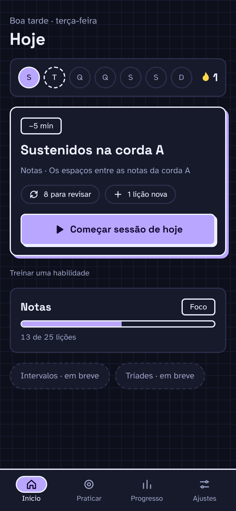

**Objetivo**

- Ponto de entrada do app: mostrar a semana e o streak e levar direto à sessão do dia.

**Elementos**

- Saudação "Boa tarde · terça-feira" (15 px, texto secundário) e título "Hoje" (28 px).
- Card da semana: 7 bolinhas de 36 px com "S T Q Q S S D"; à direita, ícone de chama amarelo e o número do streak "1".
- Card da sessão do dia, em destaque (contorno de 2 px e sombra roxa de 4 px): tag neutra "~5 min" (28 px de altura, fundo de superfície e contorno de tinta); título "Sustenidos na corda A" (22 px); subtítulo "Notas · Os espaços entre as notas da corda A" (14 px); chips informativos "8 para revisar" (ícone de revisar) e "1 lição nova" (ícone +), 32 px de altura; botão primário "Começar sessão de hoje" com ícone play, 52 px de altura, largura total.
- Rótulo de seção "Treinar uma habilidade" (13 px, cinza).
- Card "Notas" com tag neutra "Foco", barra de progresso de 12 px preenchida em 52% e "13 de 25 lições".
- Dois chips desativados, com borda tracejada: "Intervalos · em breve" e "Tríades · em breve" (44 px). Só as duas próximas habilidades da fila aparecem.
- Barra de abas inferior: "Início" (ativa), "Praticar", "Progresso", "Ajustes".

**Estado e comportamento**

- Hoje é terça e ainda não houve prática: a bolinha "S" está preenchida em acento e a "T" tem contorno tracejado. Streak de 1 dia.
- A tag "~5 min" segue Ajustes → Tamanho da sessão.
- Os chips "8 para revisar" e "1 lição nova" somem quando o número é 0.
- "Começar sessão de hoje" abre a sessão: primeiro as revisões (formato de 10), depois a lição nova (07).
- Os chips "em breve" não respondem ao toque. As abas levam a 03, 05 e 06.

## 02 · Início

Tema escuro · Sessão concluída · pág. 3

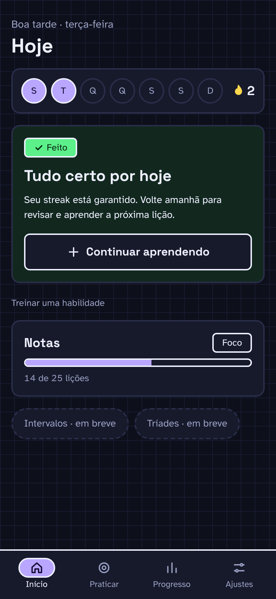

**Objetivo**

- Mostrar que a sessão do dia já foi feita e oferecer continuar aprendendo.

**Elementos**

- Mesmo topo de 01; na semana, "S" e "T" preenchidas e streak "2".
- Card da sessão em estado concluído: fundo verde-escuro (`#12281F`), tag verde "Feito" com ícone ✓ (a única tag com cor, porque indica estado), título "Tudo certo por hoje" (22 px), texto "Seu streak está garantido. Volte amanhã para revisar e aprender a próxima lição." e botão secundário "Continuar aprendendo" com ícone +.
- Card "Notas" com barra em 56% e "14 de 25 lições"; chips "em breve" e barra de abas iguais a 01.

**Estado e comportamento**

- Aparece depois de 13 Fim da sessão → "Concluir".
- "Continuar aprendendo" abre a próxima lição (07) fora da sessão diária.

## 03 · Praticar

Tema escuro · Padrão · pág. 4

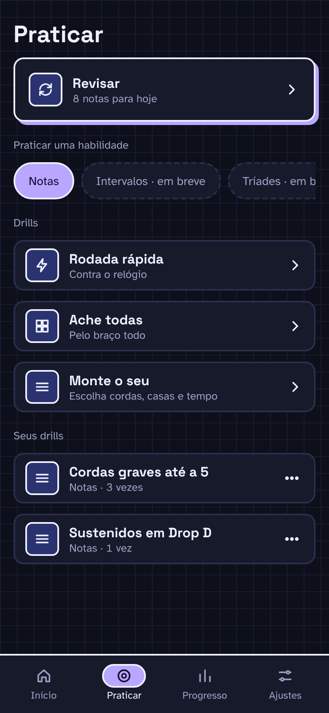

**Objetivo**

- Reunir a revisão do dia e a prática livre (drills prontos e drills salvos).

**Elementos**

- Título "Praticar" (28 px).
- Card em destaque (contorno de tinta e sombra roxa) "Revisar" · "8 notas para hoje", com ícone de revisar num quadrado de 40 px (fundo `#2A3370`) e chevron à direita.
- Rótulo "Praticar uma habilidade" e chips: "Notas" (selecionado), "Intervalos · em breve" e "Tríades · em breve" (desativados).
- Rótulo "Drills" e três linhas em card de 56 px de altura, cada uma com ícone de 40 px, nome (16 px) e descrição (13 px): "Rodada rápida" · "Contra o relógio" (ícone de raio); "Ache todas" · "Pelo braço todo" (ícone de grade); "Monte o seu" · "Escolha cordas, casas e tempo" (ícone de lista).
- Rótulo "Seus drills" e duas linhas: "Cordas graves até a 5" · "Notas · 3 vezes" e "Sustenidos em Drop D" · "Notas · 1 vez", cada uma com botão "⋯" de 44 px.
- Barra de abas com "Praticar" ativa.

**Estado e comportamento**

- "Revisar" abre as revisões pendentes no formato de 10 (máximo de 20 por sessão).
- "Rodada rápida" abre a intro do drill (20 perguntas, 3 s cada) [a confirmar: tela de intro e barra de tempo ainda não desenhadas].
- "Ache todas" é P1 [a confirmar: tela não desenhada]. "Monte o seu" abre 04.
- Tocar numa linha de "Seus drills" começa o drill; o "⋯" abre o menu Editar / Duplicar / Apagar.
- Drills são prática livre: não alteram a repetição espaçada nem o progresso.

## 04 · Monte o seu

Tema escuro · "Mais opções" aberto, drill salvo · pág. 5

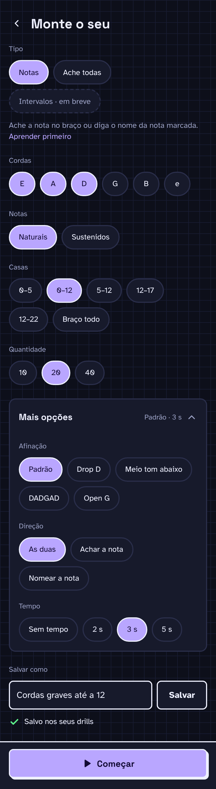

A tela rola; a imagem mostra a tela inteira.

**Objetivo**

- Criar um drill personalizado escolhendo cordas, notas, casas, quantidade e opções avançadas.

**Elementos**

- Topo: botão voltar (44 px) e título "Monte o seu" (24 px). A tela rola; a imagem mostra a tela inteira em duas partes.
- "Tipo": chips "Notas" (selecionado), "Ache todas" e "Intervalos · em breve" (desativado); texto "Ache a nota no braço ou diga o nome da nota marcada." e link "Aprender primeiro".
- "Cordas": chips "E", "A", "D" (selecionados), "G", "B", "e" — seleção múltipla.
- "Notas": "Naturais" (selecionado), "Sustenidos".
- "Casas": "0–5", "0–12" (selecionado), "5–12", "12–17", "12–22", "Braço todo".
- "Quantidade": "10", "20" (selecionado), "40".
- Card "Mais opções", aberto, com resumo "Padrão · 3 s" e chevron: "Afinação" (Padrão selecionado, Drop D, Meio tom abaixo, DADGAD, Open G); "Direção" (As duas selecionado, Achar a nota, Nomear a nota); "Tempo" (Sem tempo, 2 s, 3 s selecionado, 5 s).
- "Salvar como": campo de texto (52 px) com "Cordas graves até a 12" e botão secundário "Salvar"; abaixo, mensagem de sucesso com ✓ verde "Salvo nos seus drills".
- Rodapé fixo com botão primário "Começar" (ícone play, largura total).

**Estado e comportamento**

- Chips selecionados ficam em acento com contorno; os demais em superfície com borda clara.
- Cordas aceitam várias escolhas (pelo menos uma); os outros grupos aceitam uma.
- "Mais opções" recolhe e expande; fechado mostra só o resumo "Padrão · 3 s".
- "Salvar" com nome adiciona o drill em 03 → Seus drills e mostra "Salvo nos seus drills". Sem nome, mostra "Dê um nome ao drill primeiro" [a confirmar: estado de erro não desenhado].
- "Começar" inicia o drill com as opções atuais, salvo ou não. "Aprender primeiro" abre a lição correspondente (07).

## 05 · Progresso

Tema escuro · Casas 0–12, posição selecionada · pág. 6

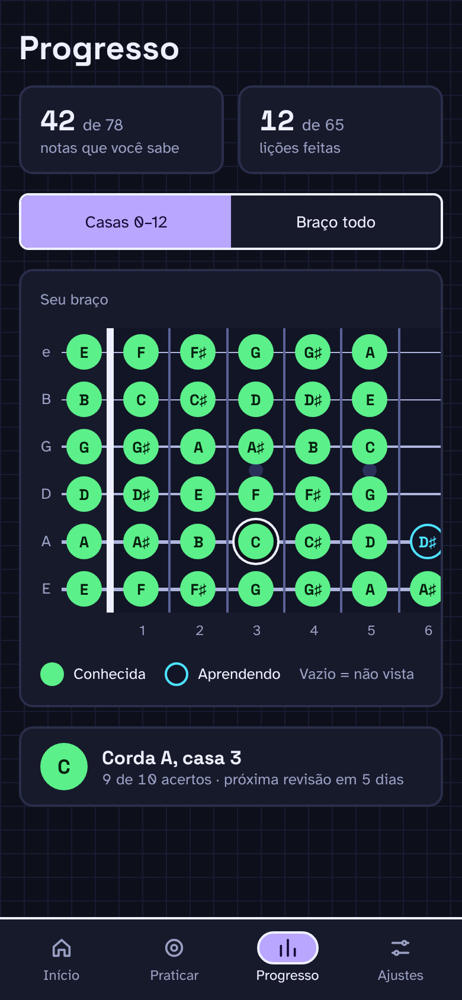

**Objetivo**

- Mostrar no mapa do braço quais notas o usuário já sabe, quais está aprendendo e quais ainda não viu.

**Elementos**

- Título "Progresso" (28 px).
- Dois cards lado a lado: "42 de 78" · "notas que você sabe" e "12 de 65" · "lições feitas".
- Controle segmentado (44 px): "Casas 0–12" (ativo) e "Braço todo".
- Card "Seu braço" com o mapa das casas 0 a 12 (650 px de largura, rola na horizontal): círculos verdes preenchidos = conhecida; círculos com contorno ciano = aprendendo; vazio = não vista. Legenda "Conhecida", "Aprendendo", "Vazio = não vista".
- Card de detalhe: marcador verde de 40 px "C", "Corda A, casa 3" e "9 de 10 acertos · próxima revisão em 5 dias".
- Barra de abas com "Progresso" ativa.

**Estado e comportamento**

- A posição corda A, casa 3 está selecionada (anel duplo em volta do marcador) e o card de detalhe mostra os dados dela.
- Conhecida = intervalo de revisão de pelo menos uma semana.
- Tocar noutra posição troca o detalhe. "Braço todo" mostra as casas 0–22.

Tema claro · pág. 7: mesma tela em tema claro (`../assets/design/progresso-posicao-selecionada-claro.png`).

## 06 · Ajustes

Tema escuro · Padrão · pág. 8

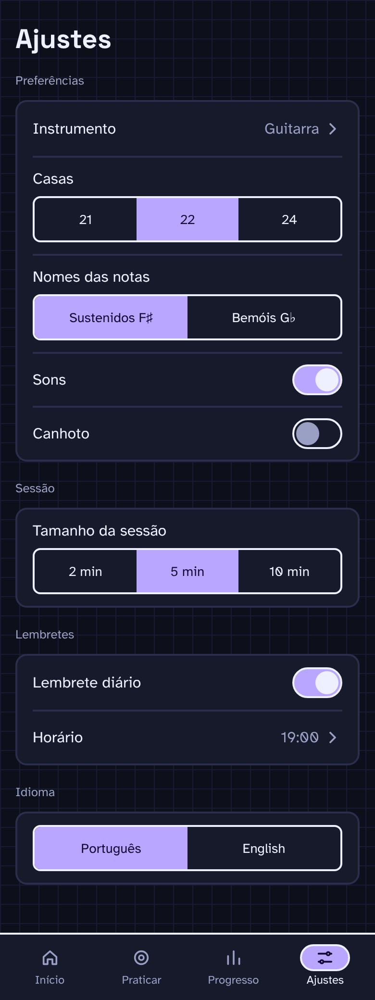

A tela rola; a imagem mostra a tela inteira.

**Objetivo**

- Ajustar preferências do instrumento, da sessão, dos lembretes e do idioma.

**Elementos**

- Título "Ajustes" (28 px). A tela rola; a imagem mostra a tela inteira em duas partes.
- "Preferências" (card com linhas de 56 px): "Instrumento" · "Guitarra" com chevron; "Casas" com segmentado "21 / 22 / 24" (22 ativo); "Nomes das notas" com segmentado "Sustenidos F♯ / Bemóis G♭" (Sustenidos ativo); "Sons" com switch ligado; "Canhoto" com switch desligado.
- "Sessão": "Tamanho da sessão" com segmentado "2 min / 5 min / 10 min" (5 min ativo).
- "Lembretes": "Lembrete diário" com switch ligado; "Horário" · "19:00" com chevron.
- "Idioma": segmentado "Português / English" (Português ativo).
- Barra de abas com "Ajustes" ativa.

**Estado e comportamento**

- Tudo salva na hora, sem botão de salvar.
- "Instrumento" e "Horário" abrem seletores [a confirmar: seletores não desenhados].
- "Canhoto" espelha o braço em todas as telas. "Nomes das notas" muda a grafia em todo o app. "Tamanho da sessão" muda a tag de 01.
- Lembretes são P1.

## 07 · Lição · Aprender

Tema escuro · Explicação 1 de 2 · pág. 9

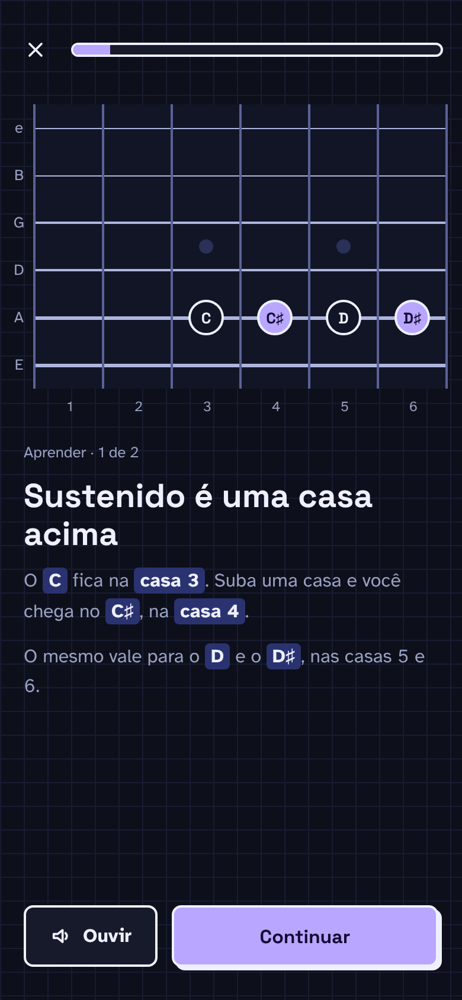

**Objetivo**

- Primeira fase da lição ("Veja"): mostrar o truque no braço antes de qualquer pergunta.

**Elementos**

- Topo fixo: botão "✕" (44 px, sair) e barra de progresso da sessão (12 px) em 10%.
- Braço com janela de 6 casas (1 a 6), 6 cordas de 40 px com rótulos "e B G D A E": notas de referência "C" e "D" (círculo com contorno) e notas da lição "C♯" e "D♯" (círculo roxo) na corda A.
- Rótulo "Aprender · 1 de 2" (13 px, cinza).
- Título "Sustenido é uma casa acima" (28 px).
- Texto (16 px) com marca-texto nas notas e casas: "O C fica na casa 3. Suba uma casa e você chega no C♯, na casa 4." e "O mesmo vale para o D e o D♯, nas casas 5 e 6."
- Botão secundário "Ouvir" (ícone de alto-falante) e botão primário "Continuar".

**Estado e comportamento**

- "Ouvir" toca as notas destacadas em sequência.
- "Continuar" vai para a explicação 2 de 2 e depois para 08.
- "✕" pede confirmação "Sair da sessão? Esta rodada não será salva." [a confirmar: diálogo não desenhado].

## 08 · Lição · Treinar

Tema escuro · Pergunta "Que nota é essa?" · pág. 10

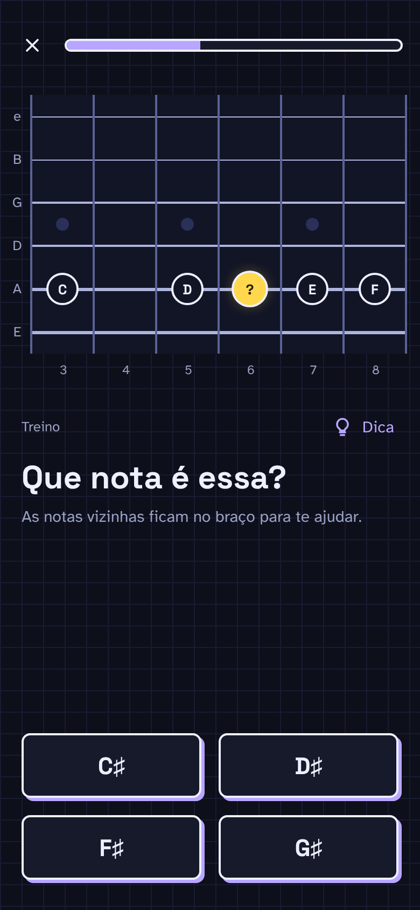

**Objetivo**

- Segunda fase ("Tente"): perguntar com ajuda, usando notas de referência e dica.

**Elementos**

- Topo fixo: "✕" e barra de progresso em 40%.
- Braço com janela das casas 3 a 8: alvo amarelo "?" com brilho na corda A, casa 6; referências "C", "D", "E", "F" nas casas 3, 5, 7 e 8.
- Rótulo "Treino" e link "Dica" (15 px, lilás) com ícone de lâmpada, à direita.
- Pergunta "Que nota é essa?" (30 px) e subtítulo "As notas vizinhas ficam no braço para te ajudar." (15 px).
- Quatro opções em grade 2 × 2 com gap de 16 px (60 px de altura, contorno de tinta e sombra roxa de 3 px): "C♯", "D♯", "F♯", "G♯".

**Estado e comportamento**

- Um toque numa opção responde, sem confirmação, e a nota soa. "D♯" (certa) abre 09; as outras abrem 11.
- "Dica" mostra uma frase de ajuda sem dar a resposta [a confirmar: visual da dica não desenhado].
- Outros tipos de pergunta usam o mesmo layout trocando o texto e a interação: "Ache o A na corda G", "Ache o B na casa 12" e "Toque na corda B solta" respondem tocando no braço (ver 14).

Tema claro · pág. 11: mesma tela em tema claro (`../assets/design/licao-treinar-claro.png`).

## 09 · Lição · Acerto

Tema escuro · Feedback de acerto · pág. 12

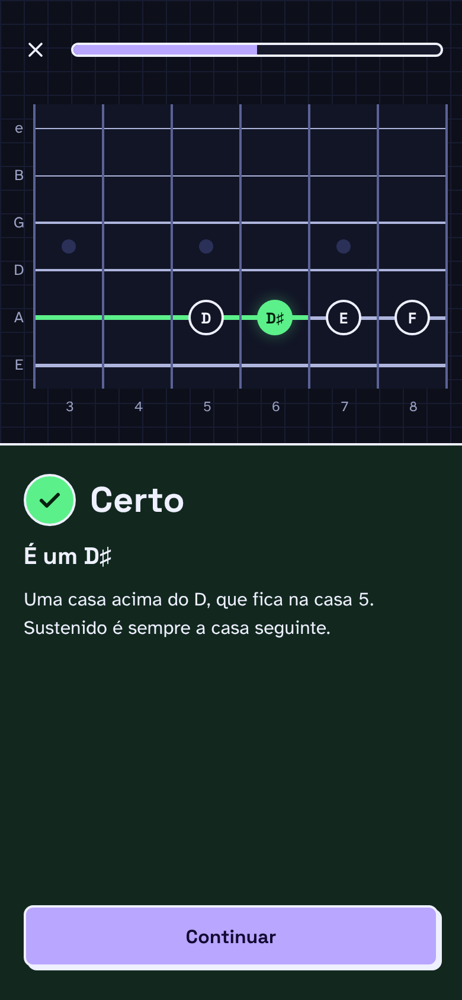

**Objetivo**

- Confirmar a resposta certa e reforçar o truque antes da próxima pergunta.

**Elementos**

- Topo fixo: "✕" e barra de progresso em 50%.
- Braço: a nota certa "D♯" vira círculo verde com brilho na casa 6 da corda A, e a corda A fica verde e mais grossa (4 px) da pestana até a nota. Referências "D", "E", "F".
- Painel de feedback (metade inferior, fundo `#12281F`, borda superior de 2 px): selo circular verde de 44 px com ✓; título "Certo" (30 px); "É um D♯" (20 px); "Uma casa acima do D, que fica na casa 5. Sustenido é sempre a casa seguinte." (16 px); botão primário "Continuar".

**Estado e comportamento**

- O título varia, sempre sem exclamação: "Certo", "Boa", "Isso aí", "Mandou bem".
- Na fase Treinar o painel traz a explicação; em Sua vez (10) só o título e a nota.
- Haptic leve ao aparecer. "Continuar" leva à próxima pergunta.

## 10 · Lição · Sua vez

Tema escuro · Pergunta com 12 opções · pág. 13

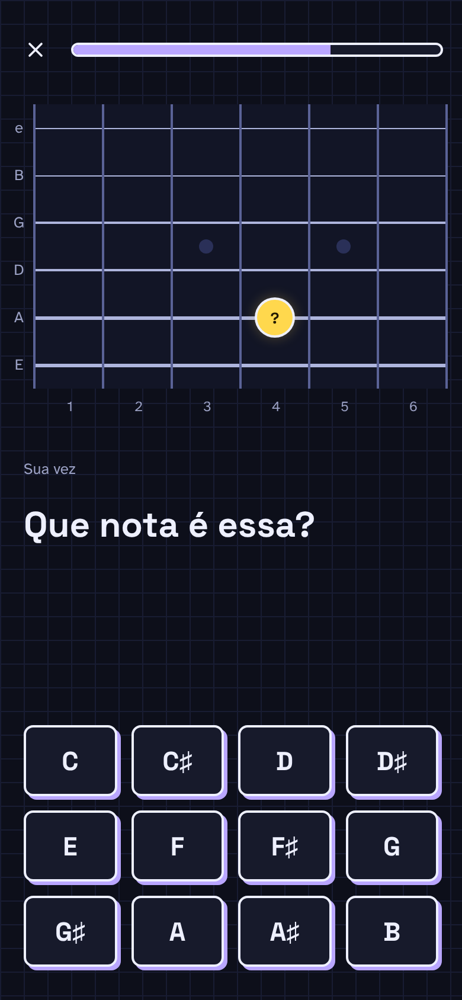

**Objetivo**

- Terceira fase ("Prove"): perguntar sem ajuda. Também é o formato das revisões.

**Elementos**

- Topo fixo: "✕" e barra de progresso em 70%.
- Braço com janela das casas 1 a 6 e só o alvo "?" na corda A, casa 4 (sem referências).
- Rótulo "Sua vez" (sem link de dica).
- Pergunta "Que nota é essa?" (30 px).
- Doze opções em grade 4 × 3, ordem cromática: "C", "C♯", "D", "D♯", "E", "F", "F♯", "G", "G♯", "A", "A♯", "B".

**Estado e comportamento**

- Lição com sustenidos ou bemóis: 12 opções (esta imagem). Lição só de notas naturais: 7 opções, "C" a "B", em grade de 4 colunas.
- "C♯" (certa) abre o acerto (09, sem explicação longa); as outras abrem 11.
- Revisões alimentam a repetição espaçada; drills livres não.

## 11 · Lição · Erro

Tema escuro · Feedback de erro · pág. 14

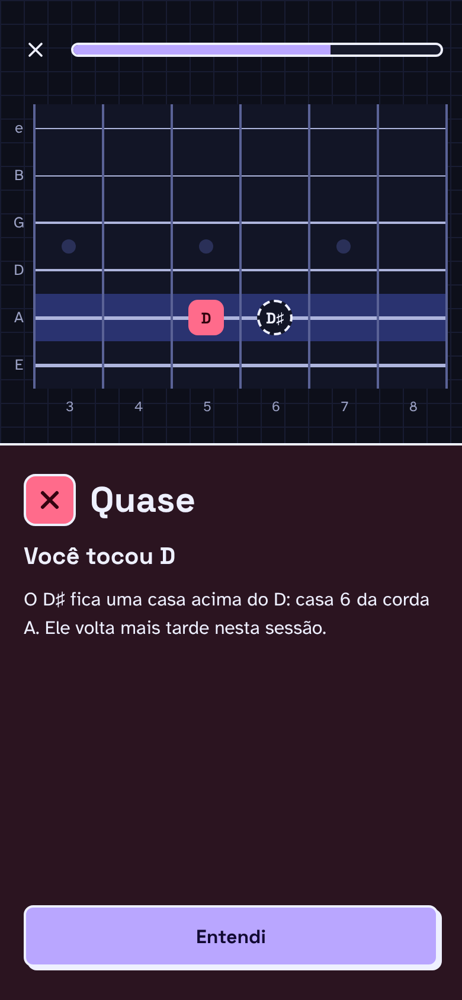

**Objetivo**

- Mostrar o que foi tocado, onde estava a nota certa e por quê.

**Elementos**

- Topo fixo: "✕" e barra de progresso em 70%.
- Braço com a corda A destacada: a nota tocada "D" como quadrado arredondado rosa na casa 5 e a certa "D♯" como círculo tracejado (revelada) na casa 6.
- Painel de feedback (fundo `#2B1420`, borda superior de 2 px): selo quadrado rosa de 44 px com ✕; título "Quase" (30 px); "Você tocou D" (20 px); "O D♯ fica uma casa acima do D: casa 6 da corda A. Ele volta mais tarde nesta sessão." (16 px); botão primário "Entendi".

**Estado e comportamento**

- Quando o tempo acaba (drills com tempo), a segunda linha vira "É um A".
- Haptic duplo ao aparecer. "Entendi" leva à próxima pergunta; a errada volta para o fim da fila.

Tema claro · pág. 15: mesma tela em tema claro (`../assets/design/licao-erro-claro.png`).

## 12 · Fim da lição

Tema escuro · 2 de 3 estrelas · pág. 16

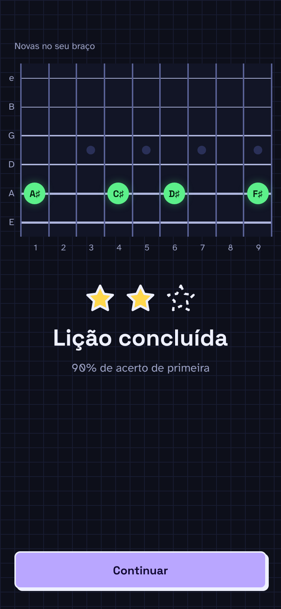

**Objetivo**

- Celebrar a lição concluída e mostrar no braço as notas novas.

**Elementos**

- Rótulo "Novas no seu braço" e braço das casas 1 a 9 com as notas aprendidas em verde na corda A: "A♯", "C♯", "D♯", "F♯".
- Três estrelas de 48 px: duas preenchidas em amarelo, a terceira só com contorno tracejado.
- Título "Lição concluída" (32 px) e "90% de acerto de primeira" (16 px).
- Botão primário "Continuar" no rodapé.

**Estado e comportamento**

- Estrelas: 3 com 95% ou mais de acerto de primeira, 2 com 80% ou mais, 1 abaixo disso.
- "Continuar" vai para 13 (ou volta para a sessão, se ainda houver revisões).

## 13 · Fim da sessão

Tema escuro · Streak mantido · pág. 17

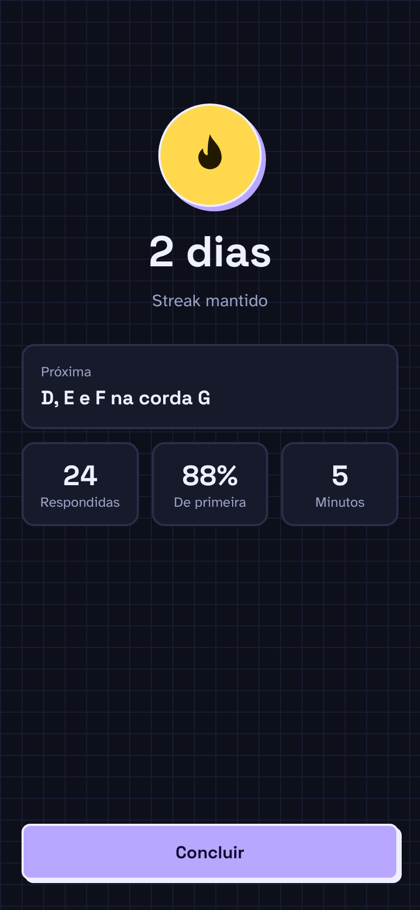

**Objetivo**

- Resumir a sessão do dia e mostrar o que vem amanhã.

**Elementos**

- Círculo amarelo de 96 px com chama, contorno de 2 px e sombra roxa.
- Título "2 dias" (40 px) e "Streak mantido" (16 px).
- Card "Próxima" · "D, E e F na corda G".
- Três cards de números: "24" · "Respondidas", "88%" · "De primeira", "5" · "Minutos".
- Botão primário "Concluir" no rodapé.

**Estado e comportamento**

- "Concluir" leva a 02.
- Ao terminar um drill aparece também o botão "De novo", que refaz o mesmo drill [a confirmar: variante não desenhada].

## 14 · Paisagem · Pergunta

Tema escuro · "Ache o C♯ na corda A" · pág. 18

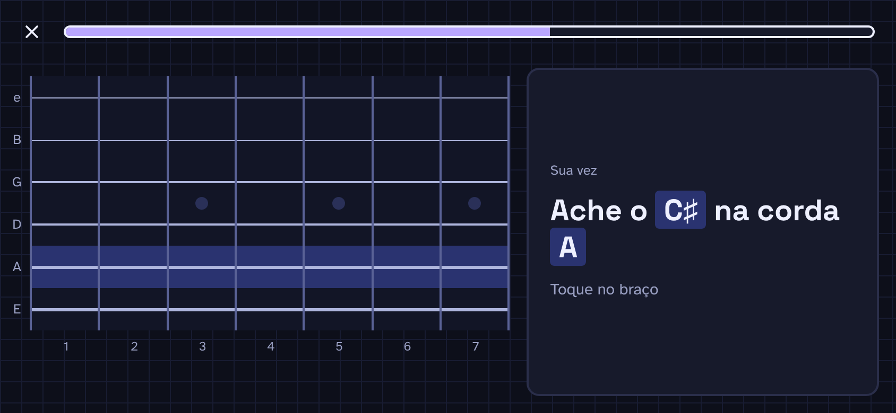

**Objetivo**

- Validar o layout expandido da pergunta (paisagem ou tablet).

**Elementos**

- Topo: "✕" e barra de progresso em 60%, largura total.
- Braço à esquerda (60% da largura), casas 1 a 7, com a corda A inteira destacada (corda-alvo).
- Painel à direita (40%), num card: rótulo "Sua vez", pergunta "Ache o C♯ na corda A" (28 px, "C♯" e "A" com marca-texto) e "Toque no braço".
- Sem barra de abas (a lição ocupa a tela toda).

**Estado e comportamento**

- O usuário responde tocando numa casa da corda destacada (área de toque = a célula inteira). Não há botões de nota neste tipo de pergunta.
- O feedback (09 ou 11) substitui o conteúdo do painel da direita; o braço mostra o resultado como em retrato.
- No desktop, o hover destaca a casa sob o cursor. Sem atalhos de teclado.

## 15 · Paisagem · Progresso

Tema escuro · Casas 0–12 · pág. 19

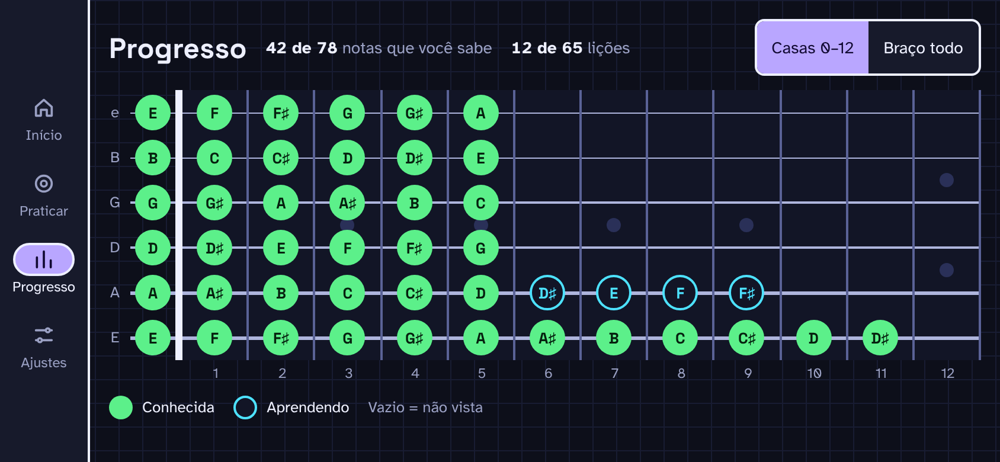

**Objetivo**

- Validar o layout expandido do Progresso, com o braço inteiro visível.

**Elementos**

- Rail lateral de 76 px com as 4 abas: "Início", "Praticar", "Progresso" (ativa), "Ajustes".
- Linha do topo: título "Progresso" (24 px), "42 de 78 notas que você sabe", "12 de 65 lições" e o segmentado "Casas 0–12" (ativo) / "Braço todo".
- Mapa das casas 0 a 12 inteiro, sem rolagem, com as mesmas marcações de 05.
- Legenda "Conhecida", "Aprendendo", "Vazio = não vista".

**Estado e comportamento**

- Nenhuma posição selecionada.
- Tocar numa posição mostra o detalhe [a confirmar: em paisagem, popover sobre o mapa, não desenhado].
- "Braço todo" pode exigir rolagem ou casas mais estreitas [a confirmar].
