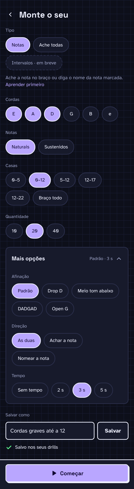

# F11 · Afinações alternativas

## Resumo

> Pendente: confirmar comportamento vigente; material descreve produto proposto.

## Rotas/Telas

## 04 · Monte o seu

Tema escuro · "Mais opções" aberto, drill salvo · pág. 5

A tela rola; a imagem mostra a tela inteira.

**Objetivo**

- Criar um drill personalizado escolhendo cordas, notas, casas, quantidade e opções avançadas.

**Elementos**

- Topo: botão voltar (44 px) e título "Monte o seu" (24 px). A tela rola; a imagem mostra a tela inteira em duas partes.
- "Tipo": chips "Notas" (selecionado), "Ache todas" e "Intervalos · em breve" (desativado); texto "Ache a nota no braço ou diga o nome da nota marcada." e link "Aprender primeiro".
- "Cordas": chips "E", "A", "D" (selecionados), "G", "B", "e" — seleção múltipla.
- "Notas": "Naturais" (selecionado), "Sustenidos".
- "Casas": "0–5", "0–12" (selecionado), "5–12", "12–17", "12–22", "Braço todo".
- "Quantidade": "10", "20" (selecionado), "40".
- Card "Mais opções", aberto, com resumo "Padrão · 3 s" e chevron: "Afinação" (Padrão selecionado, Drop D, Meio tom abaixo, DADGAD, Open G); "Direção" (As duas selecionado, Achar a nota, Nomear a nota); "Tempo" (Sem tempo, 2 s, 3 s selecionado, 5 s).
- "Salvar como": campo de texto (52 px) com "Cordas graves até a 12" e botão secundário "Salvar"; abaixo, mensagem de sucesso com ✓ verde "Salvo nos seus drills".
- Rodapé fixo com botão primário "Começar" (ícone play, largura total).

**Estado e comportamento**

- Chips selecionados ficam em acento com contorno; os demais em superfície com borda clara.
- Cordas aceitam várias escolhas (pelo menos uma); os outros grupos aceitam uma.
- "Mais opções" recolhe e expande; fechado mostra só o resumo "Padrão · 3 s".
- "Salvar" com nome adiciona o drill em 03 → Seus drills e mostra "Salvo nos seus drills". Sem nome, mostra "Dê um nome ao drill primeiro" [a confirmar: estado de erro não desenhado].
- "Começar" inicia o drill com as opções atuais, salvo ou não. "Aprender primeiro" abre a lição correspondente (07).

## Estados e ações

## 12. Escopo v0.1

1. Currículo de Notes, fase 1 (0–12)
2. Motor de lição LEARN → PRACTICE → YOUR TURN, com fila de reapresentação dos erros
3. Os 4 tipos de pergunta + explicações geradas (contagem, oitava, dots)
4. SRS por posição (1d → 3d → 7d → 30d) + Review
5. Sessão diária + streak
6. Progress (mapa + chips + filtro)
7. Build your own completo (More options com Direction e Timer) + drills salvos + Speed round como drill predefinido
8. Settings: sustenidos/bemóis, canhoto, sons, trastes
9. Layout responsivo retrato + paisagem
10. **Etapa final do MVP: afinações alternativas na prática de notas.** Drop D · Half step down · DADGAD · Open G, opção *Tuning* em More options. Vale **só para Notes**.
    - A afinação vale para drills, Speed round e Find every. Lições e SRS continuam em Standard.
    - Prática em outras afinações **não conta para o progresso**.
    - Custo técnico baixo: `noteAt()` já recebe `Tuning`. O trabalho está em UI, explicações (o truque da oitava muda em DADGAD e Open G) e testes.

**v0.2:** Find every, fase 2 do currículo, lembretes diários, tour.

## Critérios de aceite vigentes

Nenhum comportamento implementado confirmado.

## Pendências

> Pendente: confirmar estados vazios, carregamento e erros aplicáveis.
