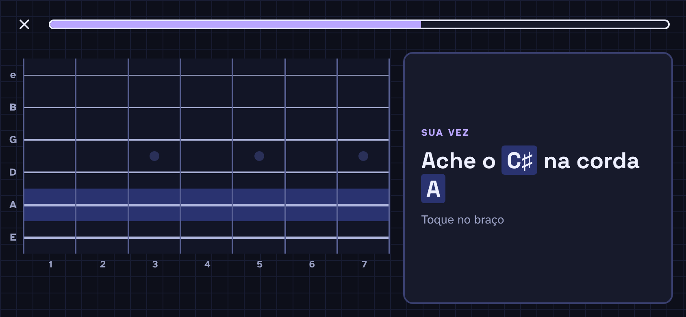

# F1 · Braço interativo

## Resumo

> `fretboard_core` fornece núcleo Dart puro para afinação padrão: notas e posições nas seis cordas e casas 0–22, oitavas, marcadores de casa e caminho cromático de contagem. O spike atual oferece uma amostra de tokens e fontes com temas escuro, claro e sistema; veja [avaliação das fontes](../spike-fontes.md). O spike descartável também permite abrir um braço de seis cordas, tocar células, deslocar uma janela de seis casas entre 0 e 22 e espelhar horizontalmente para canhotos. Veja [evidências do spike](../spike-m0.md). O braço definitivo ainda não está implementado.

## Rotas/Telas

## 14 · Paisagem · Pergunta

Tema escuro · "Ache o C♯ na corda A" · pág. 18

**Objetivo**

- Validar o layout expandido da pergunta (paisagem ou tablet).

**Elementos**

- Topo: "✕" e barra de progresso em 60%, largura total.
- Braço à esquerda (60% da largura), casas 1 a 7, com a corda A inteira destacada (corda-alvo).
- Painel à direita (40%), num card: rótulo "Sua vez", pergunta "Ache o C♯ na corda A" (28 px, "C♯" e "A" com marca-texto) e "Toque no braço".
- Sem barra de abas (a lição ocupa a tela toda).

**Estado e comportamento**

- O usuário responde tocando numa casa da corda destacada (área de toque = a célula inteira). Não há botões de nota neste tipo de pergunta.
- O feedback (09 ou 11) substitui o conteúdo do painel da direita; o braço mostra o resultado como em retrato.
- No desktop, o hover destaca a casa sob o cursor. Sem atalhos de teclado.

## Estados e ações

- `PitchClass` enumera as doze classes cromáticas começando em C.
- `Tuning` guarda afinação com cordas da grave para a aguda; `standardGuitar` usa E–A–D–G–B–E e casas 0–22.
- `noteAt` e `positionsOf` calculam notas e posições; posições/casas fora dos limites lançam `RangeError`.
- `octaveOf` retorna posição duas cordas acima quando disponível, ou `null` quando não há posição válida.
- `inlayIndex` retorna 0 sem marcador, 1 para marcador simples e 2 para marcador duplo nas casas 12 e 24.
- `countPath` retorna classes cromáticas após a nota inicial até incluir a nota final; mesma nota produz caminho vazio.

## 1. Navegação

- **Home · Practice · Progress · Settings**. No exemplo fica numa barra lateral, em paisagem ✅
- O braço é horizontal e é o centro das telas de treino ✅
- **Viewport dinâmico** ✅: o braço não aparece inteiro durante uma pergunta. O app mostra uma janela de ~5 a 6 trastes em volta do alvo (vimos janelas 0–5, 5–9, 7–12, 9–15) e escolhe a janela a cada pergunta. Com 22 trastes isso vira obrigatório.
- **Faixa visível ≠ faixa de perguntas**: o braço é desenhado no mínimo até a **casa 15** (ou até o fim da faixa do drill, se ela passar do 15). As perguntas ficam dentro da faixa do drill (padrão 0–12). Assim as notas perto da casa 12 sempre têm contexto visual dos dois lados.

## Critérios de aceite planejados para M1

Os critérios abaixo descrevem o trabalho planejado; o braço definitivo ainda não está implementado.

- AC-F1-01: `fretboard_core` calcula a nota em cada posição das 6 cordas e casas 0–22 na afinação padrão, e lista todas as posições de uma nota nessa faixa.
- AC-F1-02: o núcleo calcula oitavas, marcadores do braço e caminho de contagem entre notas, cobrindo limites e cordas/casas inválidas com testes unitários.
- AC-F1-03: explicações geradas para as perguntas de nota cobrem os exemplos documentados e têm snapshots estáveis.
- AC-F1-04: braço definitivo permite tocar a célula inteira, exibe janela dinâmica de casas, mantém contexto visual até a casa 15 e espelha horizontalmente no modo canhoto sem inverter cordas.
- AC-F1-05: braço funciona em compacto e expandido; Linux desktop cobre interação por mouse/hover e Android cobre toque, sem depender de áudio para responder.

## Pendências

> Pendente: confirmar estados vazios, carregamento e erros aplicáveis.

## Decisões da entrevista — rodada 3

Se o áudio estiver indisponível, permitir continuar sem som e avisar que o app está sem som.
