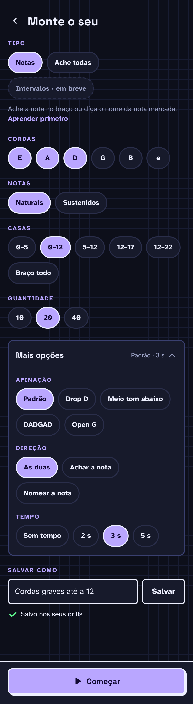

# F7 · Build your own

## Resumo

> Pendente: confirmar comportamento vigente; material descreve produto proposto.

## Rotas/Telas

### 2.4 Monte o seu

**O que é:** formulário para criar um drill personalizado. Tela com rolagem; o botão **▶ Começar** fica fixo no rodapé.

**Como funciona:**
- **Tipo:** Notas · Ache todas (outras "em breve"). Embaixo, descrição do tipo e o link **Aprender primeiro** (abre a lição correspondente).
- **Cordas:** E A D G B e — seleção **múltipla** (pelo menos uma).
- **Notas:** Naturais / Sustenidos.
- **Casas:** 0–5 · **0–12** (padrão) · 5–12 · 12–17 · 12–22 · Braço todo — seleção única.
- **Quantidade:** 10 · **20** · 40.
- **Mais opções** (card recolhível; fechado mostra o resumo "Padrão · 3 s"; o screenshot mostra aberto):
  - Afinação: Padrão, Drop D, Meio tom abaixo, DADGAD, Open G.
  - Direção: As duas, Achar a nota, Nomear a nota.
  - Tempo: Sem tempo, 2 s, **3 s**, 5 s.
- **Salvar como:** campo + botão **Salvar**.
  - Sucesso (desenhado): "✓ Salvo nos seus drills." O drill aparece em Praticar → Seus drills.
  - Erro (não desenhado): "Dê um nome ao drill primeiro." com o campo em destaque de erro.
- **▶ Começar** usa as opções atuais, salvo ou não.

## Estados e ações

## 6. Build your own ✅

Na lateral fica a habilidade (Notes · Intervals · Triads · Scales · Find every). Cada uma tem uma descrição de uma linha e um link **Learn it first**.

| Opção | Valores no exemplo | Nosso app (22 trastes) |
|---|---|---|
| Strings | E A D G B e (liga/desliga cada uma) | igual |
| Notes | Naturals / Sharps | igual |
| Frets | 0–5 · **0–12** · 0–15 · 5–12 · 12–15 | 0–5 · **0–12** · 5–12 · 12–17 · 12–22 · **Braço todo (0–22)** |
| Length | 10 · **20** · 40 | igual |
| **More options ▾** | resumo: "Standard · 3s timer" | igual |
| ↳ Tuning | **Standard** · Drop D · Half step down · DADGAD · Open G | igual |
| ↳ Direction | **Both** · Find the note · Name the note | igual |
| ↳ Timer | No timer · 2s · **3s** · 5s | igual |
| Save as | Campo de nome + **Save** | igual |
| Ação | **Start** (topo) | igual |

- Salvar sem nome mostra o erro "*Give the drill a name first.*" Com sucesso: "*Saved to your drills.*" ✅
- **Start** abre a mesma tela de intro do Speed round, com os valores escolhidos ("20 questions, 5 seconds each") ✅. Ou seja, o **Speed round é só um drill predefinido** (todas as cordas, 0–12, 20 perguntas, 3s).
- **Padrão de Frets = 0–12** em todo drill novo. Faixas acima do 12 são opt-in.
- **Find every**: Length 5 · 10 · 20, e More options só "Standard" (sem timer).

## Critérios de aceite vigentes

Nenhum comportamento implementado confirmado.

## Pendências

> Pendente: confirmar estados vazios, carregamento e erros aplicáveis.
