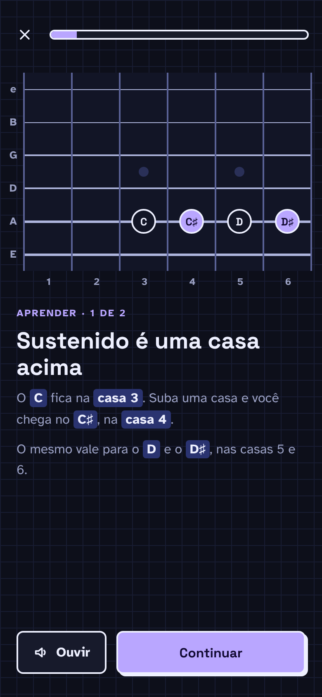

# F2 · Lições de Notes

## Resumo

> Pendente: confirmar comportamento vigente; material descreve produto proposto.

## Rotas/Telas

### 3.1 Aprender ("Veja")



**O que é:** a primeira fase da lição. Mostra o "truque" antes de perguntar qualquer coisa.

**Como funciona:**
- O braço mostra as notas da lição (roxo, `accent`) e as notas de apoio (contorno).
- Rótulo **APRENDER · 1 DE 2** (a lição pode ter mais de uma tela de explicação).
- Título do truque + texto curto. Notas e casas citadas aparecem com **marca-texto** (`board-hi`).
- **🔊 Ouvir** toca as notas destacadas em sequência.
- **Continuar** → próxima explicação ou fase Treinar.

## Estados e ações

## 3. Fluxo de uma lição

```
LEARN (n passos) → PRACTICE (com apoio) → YOUR TURN (sem ajuda) → Lesson complete → Session done
```
Em todas as telas: barra de progresso no topo e **X** para sair ✅

### 3.1 LEARN ✅
- O braço mostra só as notas-alvo, com a corda-alvo destacada.
- Cada passo ensina um **truque** diferente. Exemplos da lição "C, B, A na corda G":
  - *Shape da corda vizinha*: A, B, C da corda A (trastes 0, 2, 3) reaparecem na corda G nos trastes 2, 4, 5. Uma linha diagonal liga os dois.
  - *Contagem*: G solta → A (tom) → B (tom) → C (semitom).
- No texto, as notas e os trastes aparecem destacados com cor. Botão **Hear it** toca as notas. Botão **Continue**.

### 3.2 PRACTICE (com apoio) ✅
- **Notas de referência** (as já conhecidas) aparecem rotuladas nas outras cordas.
- Link **Hint** com o truque.
- **Name the note** tem só 4 opções.
- O acerto mostra a explicação completa.

### 3.3 YOUR TURN (prova) ✅
- Sem referência e sem Hint. Name the note tem as **7 naturais**.
- Mistura perguntas de outras cordas já aprendidas.
- O acerto mostra um card curto. O erro mostra explicação + **Got it** (seção 4).
- **A posição errada volta mais tarde na mesma sessão** ✅ (aconteceu nas duas gravações).

### 3.4 Lesson complete ✅
- "New on your neck" (o braço com as notas novas), estrelas, "**90% right first time**" e o aviso de revisão.
- Estrelas: 3★ ≥ 95% · 2★ ≥ 80% · 1★ abaixo.

### 3.5 Session done ✅
- 🔥 "N days · Streak kept".
- **Answered · First try % · Minutes**.
- "**Next up:** D, E and F on the G string".
- Botões: **Done**. Nos drills também aparece **Again**, que repete o mesmo drill.

## Critérios de aceite vigentes

Nenhum comportamento implementado confirmado.

## Pendências

> Pendente: confirmar estados vazios, carregamento e erros aplicáveis.
