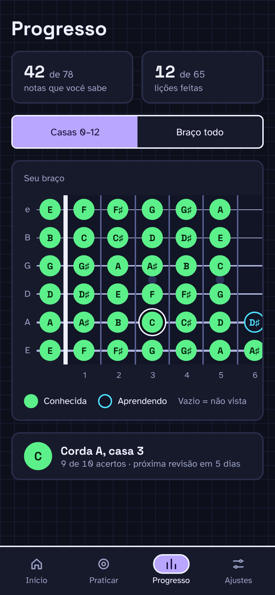
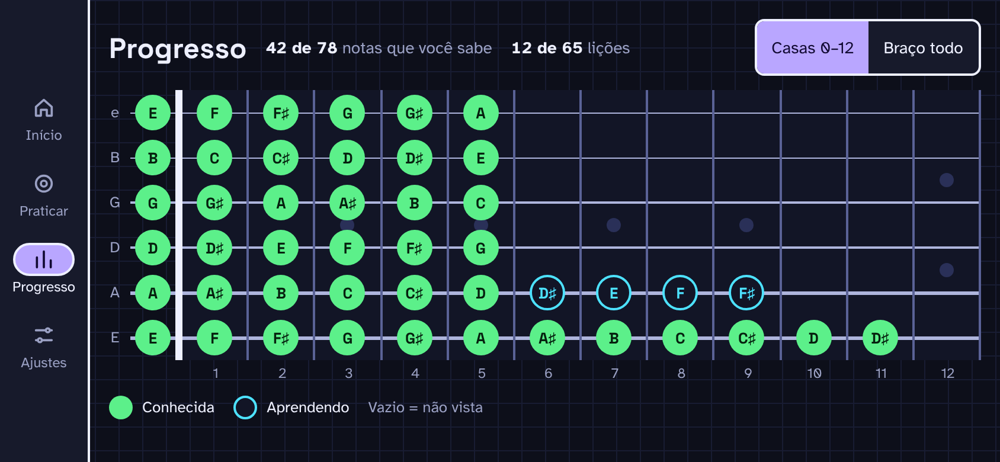

# F6 · Progresso

## Resumo

> Pendente: confirmar comportamento vigente; material descreve produto proposto.

## Rotas/Telas

## 05 · Progresso

Tema escuro · Casas 0–12, posição selecionada · pág. 6

**Objetivo**

- Mostrar no mapa do braço quais notas o usuário já sabe, quais está aprendendo e quais ainda não viu.

**Elementos**

- Título "Progresso" (28 px).
- Dois cards lado a lado: "42 de 78" · "notas que você sabe" e "12 de 65" · "lições feitas".
- Controle segmentado (44 px): "Casas 0–12" (ativo) e "Braço todo".
- Card "Seu braço" com o mapa das casas 0 a 12 (650 px de largura, rola na horizontal): círculos verdes preenchidos = conhecida; círculos com contorno ciano = aprendendo; vazio = não vista. Legenda "Conhecida", "Aprendendo", "Vazio = não vista".
- Card de detalhe: marcador verde de 40 px "C", "Corda A, casa 3" e "9 de 10 acertos · próxima revisão em 5 dias".
- Barra de abas com "Progresso" ativa.

**Estado e comportamento**

- A posição corda A, casa 3 está selecionada (anel duplo em volta do marcador) e o card de detalhe mostra os dados dela.
- Conhecida = intervalo de revisão de pelo menos uma semana.
- Tocar noutra posição troca o detalhe. "Braço todo" mostra as casas 0–22.

Tema claro · pág. 7: mesma tela em tema claro (`../assets/design/progresso-posicao-selecionada-claro.png`).

## 15 · Paisagem · Progresso

Tema escuro · Casas 0–12 · pág. 19

**Objetivo**

- Validar o layout expandido do Progresso, com o braço inteiro visível.

**Elementos**

- Rail lateral de 76 px com as 4 abas: "Início", "Praticar", "Progresso" (ativa), "Ajustes".
- Linha do topo: título "Progresso" (24 px), "42 de 78 notas que você sabe", "12 de 65 lições" e o segmentado "Casas 0–12" (ativo) / "Braço todo".
- Mapa das casas 0 a 12 inteiro, sem rolagem, com as mesmas marcações de 05.
- Legenda "Conhecida", "Aprendendo", "Vazio = não vista".

**Estado e comportamento**

- Nenhuma posição selecionada.
- Tocar numa posição mostra o detalhe [a confirmar: em paisagem, popover sobre o mapa, não desenhado].
- "Braço todo" pode exigir rolagem ou casas mais estreitas [a confirmar].

## Estados e ações

## 7. Progress ✅

- Chips: "**X of N notes you know**" e "**Y of M lessons done**".
- A unidade de progresso é a **posição (corda + traste)**. No exemplo, N = 6 × 13 = 78 (trastes 0–12).
- **Your neck**: ● verde = conhecida · ○ contorno = aprendendo · vazio = não vista.
- **No nosso app** (22 trastes): N = 6 × 23 = **138 posições**.
  - Filtro "**0–12 / braço todo**" no mapa e nos chips, com **0–12 como padrão** (igual aos drills). No padrão, o mapa é **desenhado até a casa 15** e conta só as posições 0–12.
  - Mapa com rolagem horizontal em retrato; em paisagem cabe inteiro se houver espaço.
- Posição **conhecida** = intervalo SRS ≥ 7 dias.

## Critérios de aceite vigentes

Nenhum comportamento implementado confirmado.

## Pendências

> Pendente: confirmar estados vazios, carregamento e erros aplicáveis.

## Decisões da entrevista — rodada 3

Antes da primeira lição, mostrar o braço vazio com convite para começar a sessão.
