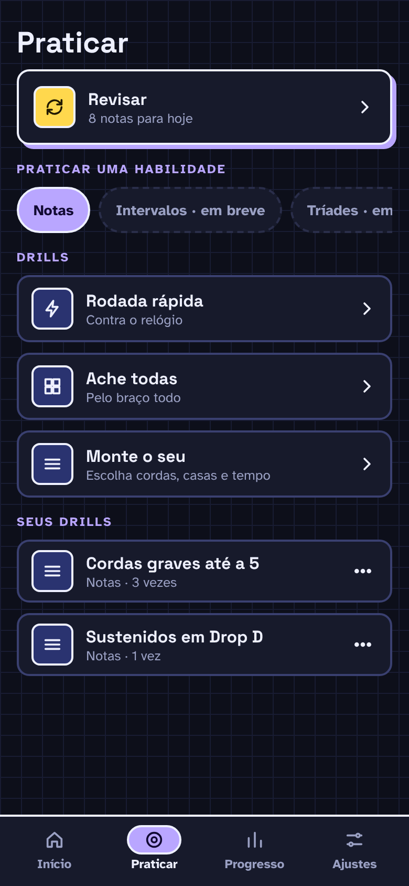

# F4 · Revisão espaçada

## Resumo

> Pendente: confirmar comportamento vigente; material descreve produto proposto.

## Rotas/Telas

### 2.3 Praticar

**O que é:** a central de prática livre e da revisão.

**Como funciona:**
- **Revisar · 8 notas para hoje** (card em destaque): abre só as revisões pendentes, no formato "Sua vez". Máximo de 20 por sessão. Com 0 pendentes, o card mostra que está em dia.
- **Praticar uma habilidade:** chips de habilidade. No MVP só **Notas** está ativa.
- **Drills:**
  - ⚡ **Rodada rápida** · "Contra o relógio" → tela de intro (20 perguntas, 3 s cada) → perguntas com barra de tempo. *(tela de intro e timer ainda não desenhadas)*
  - ▦ **Ache todas** · "Pelo braço todo" (P1) *(não desenhada)*
  - ≡ **Monte o seu** → tela 2.4.
- **Seus drills:** lista dos drills salvos com ícone, nome e "Notas · 3 vezes" (quantas vezes foi feito). Tocar na linha começa o drill; o botão **⋯** abre Editar / Duplicar / Apagar.

## Estados e ações

## 5. Practice (aba)

| Seção | Conteúdo |
|---|---|
| **Review** | Banner "Review · N notes due now" ✅ |
| Practice a skill | Intervals, Triads, Scales, Arpeggios ✅ |
| **Drills** | **Speed round** · **Find every** · **Build your own** ✅ |
| **Your drills** | Lista dos drills salvos ✅. Cada item mostra ícone da skill + nome + "**Notes · 1 start**" (skill · quantas vezes foi iniciado). Tocar no item abre a intro do drill. Menu **⋯** no item: **editar · duplicar · apagar** |

### 5.1 Review ✅
- Header "REVIEW", sem fases LEARN/PRACTICE, sem Hint e sem referências.
- Mistura Find e Name com 7 opções e posições de várias cordas e trastes (até o 12).
- Termina em "Session done" (vimos 12 respondidas, 100%, 1 min).
- A Review pega **até 20** posições vencidas; as restantes continuam pendentes (no vídeo o banner passou de 6 para 3 depois de uma revisão).

### 5.2 Speed round ✅
- Tela de intro: "Speed round · Notes · **20 questions, 3 seconds each**" + **Start**.
- **Barra de tempo amarela** sob o título "YOUR TURN", esvaziando.
- O exemplo pergunta até a casa 15, incluindo cordas soltas e "at the 12th fret". **No nosso app o padrão é 0–12.**
- Ao esgotar o tempo, conta como erro ("It's A.") e mostra a explicação.
- Final: Session done com **Again / Done** (vimos 20 respondidas, 60%, 3 min).
- Não vimos BPM nem tempo de 4 batidas. O "tempo" é só o timer por pergunta.

### 5.3 Find every ✅
- Tela de intro: "Drill · **Find every** · 10 questions" + **Start**. Sem timer.
- Pergunta: "**Tap every E** · 0 of 8 found". Aparece o **trecho inteiro da faixa** (0–12) de uma vez, com os círculos de corda solta, sem viewport dinâmico.
- Cada acerto fica **verde e permanece** no braço, e o contador sobe ("7 of 8 found").
- Tocar errado **não encerra a pergunta**: o app conta e segue.
- O total por nota inclui cordas soltas e a casa 12 (ex.: na faixa 0–12, E = 8, C = 6, D/A/G/B = 7).
- Botão **Show me** (ao lado): desiste e revela as posições restantes.
- **Feedback final**
  - Achou todas, mas errou no caminho: "Not quite · **3 wrong taps on the way.** E is in 8 places in this stretch of the neck."
  - Show me: "Not quite · **The rest are shown on the neck.** C is in 6 places in this stretch of the neck." As achadas ficam verdes e as que faltavam aparecem com contorno.
  - ⚠️ Achou todas sem erro: card verde (não aparece no vídeo; é o mesmo padrão das outras perguntas).
- **First try** da pergunta = achou todas **sem nenhum toque errado e sem Show me**.
- Final: Session done (vimos 10 respondidas, 0%, 1 min) com **Again / Done**.
- **Decidido:** Find every é **só prática livre**. Não mexe no SRS nem no mapa de progresso; conta apenas para o streak e para o resumo da sessão.

### 5.4 Sair no meio ✅
Ao tocar no X, aparece o diálogo "**Leave this session?** This round won't be saved." com **Keep going** / **Leave**.

## Critérios de aceite vigentes

Nenhum comportamento implementado confirmado.

## Pendências

> Pendente: confirmar estados vazios, carregamento e erros aplicáveis.

## Decisões da entrevista — estados

Ao abrir Revisar sem notas pendentes, oferecer revisão como prática livre. A prática livre não altera SRS nem progresso.
