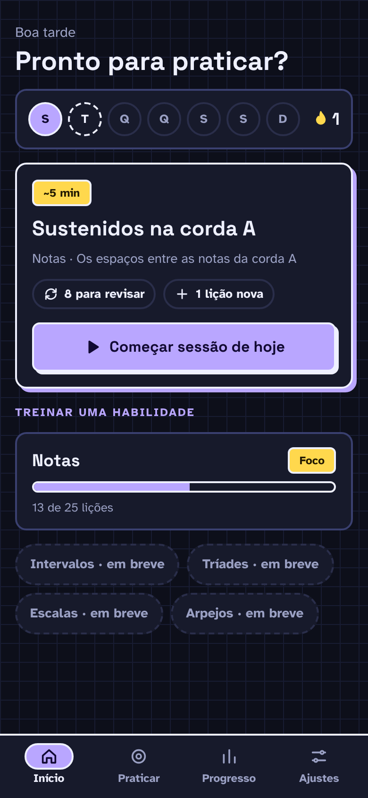

# F5 · Sessão do dia

## Resumo

> Pendente: confirmar comportamento vigente; material descreve produto proposto.

## Rotas/Telas

### 2.1 Início · sessão pendente

**O que é:** a tela de entrada do app. Mostra se o usuário já praticou hoje e leva direto para a sessão do dia.

**Como funciona:**
- Saudação conforme a hora ("Bom dia / Boa tarde / Boa noite") + "Pronto para praticar?".
- **Semana:** 7 bolinhas S T Q Q S S D. Dia praticado = preenchido em `accent`; **hoje** ainda não praticado = contorno tracejado. À direita, a chama + número do **streak**.
- **Card da sessão do dia** (em destaque, com sombra colorida):
  - tag com a duração estimada ("~5 min", conforme Ajustes → Tamanho da sessão);
  - título e subtítulo da lição nova ("Sustenidos na corda A" · "Notas · Os espaços entre as notas da corda A");
  - chips "↻ 8 para revisar" e "+ 1 lição nova" (escondem quando o número é 0);
  - botão **▶ Começar sessão de hoje** → abre a sessão (primeiro as revisões, depois a lição).
- **Treinar uma habilidade:** card de Notas com barra de progresso, "13 de 25 lições" e tag **Foco** (a habilidade atual). As outras habilidades aparecem como chips desativados "em breve".

## Estados e ações

## 2. Home

| Elemento | Detalhe |
|---|---|
| Saudação | "Good afternoon / Ready to practice?" ✅ |
| Semana | 7 bolinhas (S T Q Q S S D); o dia praticado fica preenchido ✅ |
| Streak | 🔥 + número de dias seguidos ✅ |
| **Card "Today's Session"** | Dois estados ✅ (ver abaixo) |
| **Train a skill** | Um card por habilidade, com barra de progresso e "X of N lessons". A habilidade atual leva o badge **Focus** ✅ |
| How it works | Tour de 4 slides ✅ (seção 9) |

### 2.1 Card "Today's Session" ✅

| | **Pendente** | **Concluído** |
|---|---|---|
| Badge | ⏱ **~5 min** (duração estimada) | ✓ Done |
| Título | Nome da próxima lição: "**Sharps on the A string**" | "All done for today" |
| Subtítulo | Habilidade + descrição: "Notes · The gaps between the A string's notes" | "Your streak is safe. Come back tomorrow and your notes will be ready to review." |
| Chips | **↻ 8 to review** · **+ 1 new lesson** | — |
| Botão | **▶ Start today's session** | **+ Keep learning** (próxima lição, fora da sessão) |

- A sessão do dia é **revisões vencidas + 1 lição nova**, nessa ordem (o tour diz "review, then your next lesson").
- O tamanho da sessão é configurável (**2, 5 ou 10 min**) e limita quantas revisões entram (teto de 20). ⚠️ Estimativa: `nº de revisões × ~8s + duração média de uma lição`.
- ⚠️ Sem revisões pendentes, o chip "to review" some e a sessão vira só a lição nova.
- O print confirma que **os sustenidos entram no currículo por corda** ("Sharps on the A string", na lição ~20 de 25), depois das naturais.

## Critérios de aceite vigentes

Nenhum comportamento implementado confirmado.

## Pendências

> Pendente: confirmar estados vazios, carregamento e erros aplicáveis.

## Decisões da entrevista — estados

Quando todas as lições estiverem concluídas e não houver revisões pendentes, oferecer prática livre ou revisão, dando destaque à revisão.

## Decisões da entrevista — rodada 3

Enquanto dados locais carregam, mostrar shimmer de carregamento.
