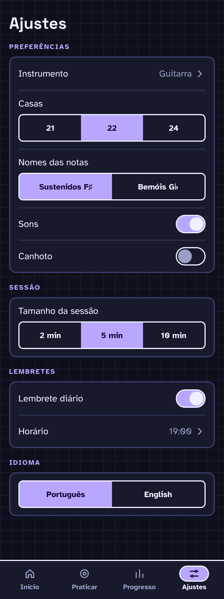

# F10 · Settings

## Resumo

> Pendente: confirmar comportamento vigente; material descreve produto proposto.

## Rotas/Telas

### 2.6 Ajustes

**O que é:** preferências do app. Lista simples em cards agrupados; tela com rolagem.

**Como funciona:**
- **Preferências:** Instrumento (Guitarra, abre seleção) · Casas 21 / **22** / 24 · Nomes das notas Sustenidos F♯ / Bemóis G♭ · Sons (switch) · Canhoto (switch).
- **Sessão:** Tamanho da sessão 2 / **5** / 10 min (muda a estimativa do card do Início).
- **Lembretes (P1):** Lembrete diário (switch) · Horário (abre seletor).
- **Idioma:** Português / English.
- Tudo salva na hora, sem botão de salvar.

---

## Estados e ações

## 8. Settings ✅

- Instrument (Guitar) · Note names (Sharps F♯ / Flats B♭) · Sounds · **Left-handed** (espelha o braço)
- Daily reminder · Reminder time · Notification settings
- ➕ **Nosso**: Trastes do instrumento (padrão **22**; opções 21/22/24) · Tamanho da sessão (**2 / 5 / 10 min**) · Idioma (PT-BR / English)

## Critérios de aceite vigentes

Nenhum comportamento implementado confirmado.

## Pendências

> Pendente: confirmar estados vazios, carregamento e erros aplicáveis.

## Decisões da entrevista

- Oferecer temas Escuro, Claro e Seguir o sistema.
- Disponibilizar português e inglês com internacionalização. Definir na implementação se o idioma será selecionável ou seguirá o sistema, conforme a opção mais simples na stack.

## Decisões da entrevista — estados

Se ajustes não puderem ser salvos, mostrar erro e permitir tentar novamente. Verificar possível falta de permissão do usuário ou do sistema.

## Decisões da entrevista — rodada 3

Progresso, configurações e treinos salvos ficam localmente no dispositivo, sem conta ou sincronização no MVP.
