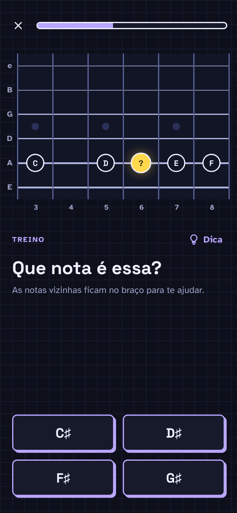

# F3 · Tipos de pergunta

## Resumo

> Pendente: confirmar comportamento vigente; material descreve produto proposto.

## Rotas/Telas

### 3.2 Treinar ("Tente")

**O que é:** a fase de prática guiada.

**Como funciona:**
- Rótulo **TREINO**, link **💡 Dica** à direita (mostra uma frase de ajuda sem dar a resposta).
- O braço mostra o **alvo "?"** (amarelo, com brilho) e as **notas de referência** vizinhas.
- Pergunta + subtítulo; **4 opções** em grade 2 × 2.
- Toque numa opção → painel de Acerto (3.3) ou Erro (3.5). A nota tocada soa.

**Outros tipos de pergunta** (mesma tela, muda o texto e a interação):
- "Ache o **A** na corda **G**" — corda-alvo destacada; o usuário **toca no braço** (sem botões de nota). Ver Paisagem (4.1).
- "Ache o **B** na **casa 12**" — toca no braço; a casa fica marcada.
- "Toque na corda **B** solta" — toca na área de corda solta.

## Estados e ações

## 4. Tipos de pergunta e feedback ✅

| Tipo | Enunciado | Interação |
|---|---|---|
| Find on string | "Find **A** on the **B** string" / "…on the **high E** string" | Tocar no traste; a corda-alvo fica destacada |
| Find at fret | "Find **B** at the **12th fret**" | Tocar na corda certa daquele traste |
| Open string | "Tap the open **B** string" | Círculos de corda solta aparecem depois da pestana |
| Name the note | "What note is this?" + marcador **?** | Botões: 4 (PRACTICE) ou 7 (demais) |

**Feedback**
- **Acerto**: card verde com título variado ("That's it!", "Yes!", "Correct!", "Nice!") e "That's X." A nota fica verde, e uma linha sai da pestana até ela.
- **Erro (tocou errado)**: "Not quite · You tapped G♯." A tocada aparece em vermelho e a correta em verde.
- **Erro (tempo esgotado)**: "Not quite · It's A." (sem "You tapped")
- **Explicação do erro**, gerada a partir de 3 padrões:
  1. *Contagem a partir de uma âncora*: "Count up from G on fret 8: G → G♯ → A". Se não há nota entre as duas, avisa: "B and C have no note between them".
  2. *Oitava*: "It's the octave of A on the D string (fret 7): **two strings up, two frets higher**". Quando a oitava cruza a corda B, vira **três** trastes.
  3. *Marcadores (dots)*: "C sits on the **second dot** of the G string, fret 5."
- Botão vermelho **Got it**.

> Os três padrões são computáveis no núcleo de teoria. Não precisa escrever explicação à mão para cada posição.

## Critérios de aceite vigentes

Nenhum comportamento implementado confirmado.

## Pendências

> Pendente: confirmar estados vazios, carregamento e erros aplicáveis.
